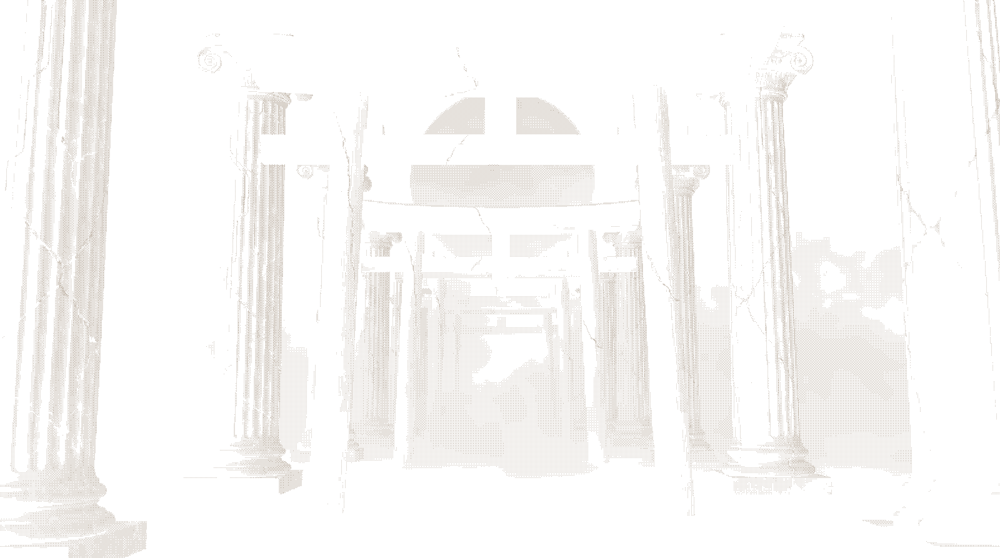

# Ryoku

**The Ryoku Project**

*力と美のために — For the sake of power and beauty.*

[Website](https://ryoku.dev) · [Documentation](https://docs.ryoku.dev) · [Contribute](https://github.com/ryoku-dev/ryoku-arch/blob/main/CONTRIBUTING.md)

## A passion project, built with the community

Ryoku is a community-first Linux passion project, led by [neur0map](https://github.com/neur0map) and maintainers in their spare time and improved by generous contributors. There is no large company or full-time engineering team behind it. We care about making something worth using, learning as we build, and giving the community a real part in shaping it.

Ideas, bug reports, documentation, testing, and code contributions all matter. What we can maintain depends on the time, knowledge, and help available. Community-first means listening and working together, not promising that every request will be included or that support is available around the clock.

Ryoku favors a rich, deliberate desktop experience on capable hardware. It is **not a lightweight distribution for older or low-resource computers**. Read each project's requirements before installing.

## Projects

<table align="center">
  <thead>
    <tr>
      <th>Project</th>
      <th>Purpose</th>
    </tr>
  </thead>
  <tbody>
    <tr>
      <td><a href="https://github.com/ryoku-dev/ryoku-arch">Ryoku Arch</a></td>
      <td>The distribution, desktop, installer, and system definition.</td>
    </tr>
    <tr>
      <td><a href="https://github.com/ryoku-dev/ryotunes">Ryotunes</a></td>
      <td>The Ryoku music application.</td>
    </tr>
    <tr>
      <td><a href="https://github.com/ryoku-dev/ryostore">Ryostore</a></td>
      <td>Community customizations and catalogue.</td>
    </tr>
    <tr>
      <td><a href="https://github.com/ryoku-dev/ryomanager">Ryomanager</a></td>
      <td>Ryoku native task manager.</td>
    </tr>
  </tbody>
</table>

 

 

### Ryoku on NixOS

[Ryoku on NixOS](https://github.com/ryoku-dev/Ryoku-on-NixOS) is our official port of Ryoku to NixOS maintained by [**aethctl**](https://github.com/aethctl).
and contributors. It shares the Ryoku identity while keeping its own implementation and maintainership. Follow that repository's installation and support guidance for NixOS.

<table align="center">
  <thead>
    <tr>
      <th>Project</th>
      <th>Purpose</th>
    </tr>
  </thead>
  <tbody>
    <tr>
      <td><a href="https://github.com/ryoku-dev/ryoku-on-nixos">Ryoku NixOS</a></td>
      <td>The distribution, desktop, installer, and system definition.</td>
    </tr>
    <tr>
      <td><a href="https://github.com/ryoku-dev/ryotunes-nix">Ryotunes for Nix</a></td>
      <td>The Ryoku music application.</td>
    </tr>
    <tr>
      <td><a href="https://github.com/ryoku-dev/ryostore-nix">Ryostore for Nix</a></td>
      <td>Community made add-ons, plugins and themes, built decoratively.</td>
    </tr>
    <tr>
      <td>Ryoshori</td>
      <td>Ryoku Nix native file manager.</td>
    </tr>
    <tr>
      <td>Ryoku-Nixsync</td>
      <td>Ryoku on NixOS' automatic updater.</td>
    </tr>
  </tbody>
</table>

<b>Explore the desktop</b>

 
<table>
  <tr>
    <td width="50%"></td>
    <td width="50%"></td>
  </tr>
  <tr>
    <td width="50%"></td>
    <td width="50%"></td>
  </tr>
</table>

  <table>
  <tr>
    <td width="50%">
      
    </td>
    <td width="50%">
      
    </td>
  </tr>
  <tr>
    <td width="50%">
      
    </td>
    <td width="50%">
      
    </td>
  </tr>
</table>

## Open source, with credit where it belongs

Ryoku depends on the work of many upstream projects. Individual repositories retain their licenses, notices, contributor credits, and fork histories. Moving them into this organization does not erase that history or transfer every contributor's copyright.

The project is founder-led, with community participation and responsibilities delegated to maintainers as they join. See our [governance](https://github.com/ryoku-dev/.github/blob/main/GOVERNANCE.md) for how decisions and stewardship work. This GitHub organization is our collaboration home; it does not itself establish nonprofit or charitable status.

## Get involved

- Report reproducible bugs in the relevant project's issue tracker.
- Discuss ideas before starting large changes.
- Help test releases, improve documentation, or contribute a focused fix.
- Respect each project's [contribution guidelines](https://github.com/ryoku-dev/ryoku-arch/blob/main/CONTRIBUTING.md) and [code of conduct](https://github.com/ryoku-dev/ryoku-arch/blob/main/CODE_OF_CONDUCT.md).
- For private project or stewardship questions: [neuro@ryoku.dev](mailto:neuro@ryoku.dev).

For security vulnerabilities, follow the affected repository's security policy instead of opening a public issue.

 

 

  

  <strong>力と美のために — For the sake of power and beauty.</strong>

